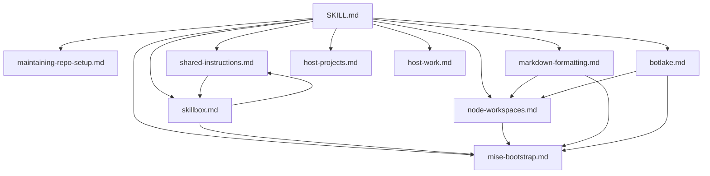

# Maintaining repo-setup

Read this reference before editing the `repo-setup` router or any of its supporting files. This is maintenance guidance for this skill's source in the dots repository, not a recipe to apply when setting up other repositories. Do not copy it into consuming repositories' instructions.

## Reference map

`SKILL.md` is the router; the files beneath it are in `references/`. Each arrow means the source file directly routes or links to the target file, not that the target must always be loaded. Follow each reference's conditions. The maintenance branch applies only when editing this skill; the other branches serve repository setup requests.

Keep this map up to date in the same change whenever a reference is added, removed, renamed, or its routing or cross-reference links change. Include every reference and every direct link between the router and references or between references; do not add inferred transitive edges. External tool documentation and this repository's contribution guides are outside the map. The shared-instructions/Skillbox cycle is conditional cross-routing, not a requirement to repeatedly reload either file.

## Keep knowledge with its owner

The underlying tools are the source of truth for their own behavior. Prefer their current bundled skills, subcommands, CLI help, and tool-owned documentation, in that order where available and appropriate. Read those sources at maintenance and setup time rather than preserving a snapshot here.

Keep `repo-setup` a thin composition layer:

- Say which outcome or condition selects a tool or reference, what discovery command to run, and when to follow its guidance.
- Point to tool-owned skills and resources instead of copying their procedures, command inventories, option descriptions, configuration schemas, or verification recipes. For example, route Skillbox work to its bundled skills and Botlake operations to its current help and operation primers.
- Retain only the repository-setup decisions the tools do not own: scope and consent, ordering across tools, shared prerequisites, and the outcomes that must be verified. Keep shared guidance in one reference and link to it from dependent workflows.
- Before adding a command or example, check whether the tool already teaches it. Prefer a small discovery pointer over a version-sensitive implementation recipe. Do not mirror tool guidance merely for convenience.
- If a discovery command or source has moved or is unavailable, inspect the tool's current help or report the blocker; do not invent syntax or silently substitute stale instructions.

The goal is for this skill to remain useful as the underlying CLIs evolve: tools explain how they work; this skill explains which guidance to use, when, and how the workflows fit together.

## Verify maintenance changes

- Confirm the router explicitly requires this reference before edits to the skill itself, without routing ordinary setup requests here.
- Check the map against the router and every reference, including conditional cross-links. Verify local links and heading anchors resolve.
- Review added content for duplicated tool-owned knowledge and replace it with discovery pointers where possible.
- Follow the dots repository's `AGENTS.md` and documentation checks in `docs/verification.md`. Preserve unrelated work and report exact checks, blockers, and untested behavior; a diagram alone is not validation.
